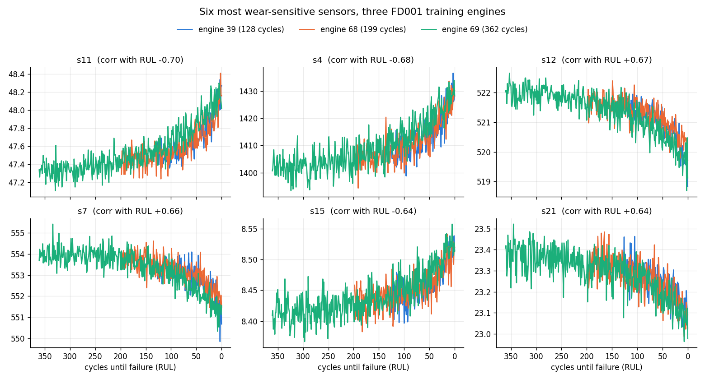
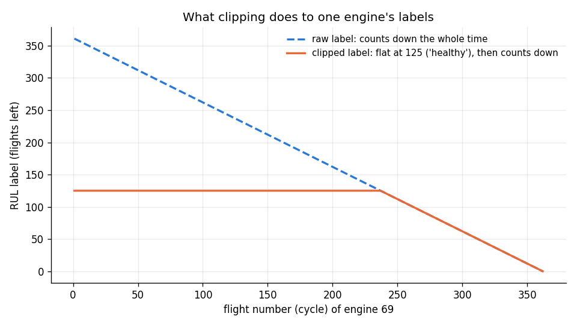

# NASA C-MAPSS Remaining Useful Life Prediction

**Goal:** predict how many flights a jet engine has left before it fails, using simulated NASA sensor data (C-MAPSS, subset FD001).

**Result:** a gradient boosting model predicts remaining life with a typical error of **18.4 flights** on 100 unseen test engines. Guessing the average for every engine gives an error of 52.6.

**Status:** Project 0 complete (Weeks 1 to 4). Next: a neural network on the same data, then NASA satellite imagery.

## Summary
- Each engine runs until it fails while 21 sensors record every flight. The task is to look at an engine partway through its life and say how many flights remain (its Remaining Useful Life, RUL).
- I built four models, each one a single change from the one before, so every improvement can be traced to its cause.
- The biggest single gain did not come from a better model. It came from changing the labels the model learns from (capping RUL at 125).
- One idea I expected to help, smoothing the sensor readings, did not help at all. That is reported below, along with the mistakes I made.
- The best model still makes a few large, unsafe mistakes on engines close to failure. That is the main open problem.

## Results
Scored on the last recorded flight of each of the 100 FD001 test engines. RMSE is the typical size of the error, in flights. Lower is better.

| Model | Test RMSE | Too high (of 100) | What changed |
|---|---|---|---|
| Mean baseline | 52.62 | 71 | Predicts the training average (107.8) for every engine; ignores the sensors |
| Linear regression, raw RUL labels | 32.04 | 85 | Uses 17 sensor and setting columns |
| Linear regression, RUL clipped at 125 | 21.90 | 58 | Same model; only the training labels changed |
| **Gradient boosting, RUL clipped at 125** | **18.36** | **53** | 100 small decision trees instead of a straight line |
| Linear regression, clipped + rolling average | 21.79 | 59 | Added smoothed sensors: no real gain |
| Gradient boosting, clipped + rolling average | 18.43 | 59 | Added smoothed sensors: no real gain |

"Too high" counts engines where the model promised more life than the engine really had. That is the unsafe direction.


These match the reference numbers I set out to reproduce for these simple models. Published deep-learning results on FD001 are typically 12 to 16.

Every number in the first four rows can be reproduced with `src/05_week4.py`.

## How I kept the testing honest
- **The test set is used once per model, only for the final score.** Every choice (which model, which settings) was made using training engines only.
- **Validation by engine, not by row.** To check a model, I hold out whole engines. Two neighboring flights of one engine are nearly identical, so splitting them across the two groups would let the model be graded on rows it has practically already seen.
- **Cross-validation.** One 20-engine check is noisy: the same model scored anywhere from 37.6 to 44.6 depending on which engines were held out. For later choices I averaged five checks, with every engine held out once.
- **Only training labels are clipped.** Test engines are always graded against NASA's true RUL values.
- **Overfitting checks.** Each model is scored on engines it studied and on engines it never saw. For the final model those are 17.57 and 18.52, so it learned a pattern instead of memorizing.

## What each step showed

### What wear looks like


Sensors are flat and noisy while an engine is healthy, then bend sharply in roughly the last 100 flights. Engines with very different lifetimes (128, 199, 362 flights) follow the same shape near failure. The sensors track *closeness to failure*, not age.

### Where a straight-line model goes wrong


The dots form a curve because a straight-line model cannot follow curved wear. It predicts impossible negative RUL near failure, flattens out around 150 to 190 for healthy engines, and guesses too high for 85 of the 100 test engines.

### What clipping and gradient boosting changed


A healthy engine's sensors look the same at 300 flights left as at 150. Clipping relabels everything above 125 as "healthy", so the model only counts down once wear shows.


Left to right, the dots tighten around the dashed "perfect" line.

## Where the best model is still wrong


The 100 test engines are sorted by how many flights they truly have left. Gradient boosting beats linear regression in every group, but its error is about 18 flights everywhere, including for engines close to failure.

Looking inside the 25 engines with 30 or fewer flights left:

- For most of them the model is close. The middle (median) miss is 4 flights, and 18 of the 25 are within 10.
- For 5 of them the model is too high by 23 to 54 flights. One engine had 18 flights left and the model said 72.
- All five had flown fewer than 170 flights, so they wore out early. I have not yet explained why the model misses them.

A few large misses in the unsafe direction matter more than the average suggests. This is the first thing I would work on next.

Clipping is not the cause. A model trained on labels capped at 125 cannot answer above 125, but a *perfect* clipped model would still score 3.74 on this test set, and leaving out the 11 healthy engines only moves the score from 18.36 to 18.00.

## What failed
- **Rolling-average features.** I expected smoothing the sensors to give a clear gain. It gave none. Cross-validation RMSE moved from 18.57 to between 18.22 and 18.49 depending on the window, while the five checks themselves range from about 16 to 20, so the differences are noise. Test RMSE went from 18.36 to 18.43. I checked the averages by hand and they are computed correctly. Likely reason (not proven): noise is not the main limit; engines differ from each other in ways smoothing cannot fix.
- **First leakage demonstration.** I tried to show that splitting by row gives a fake good score. With my real features it did not (by-row 52.60 vs by-engine 47.00). The fake boost only appears once the model can identify the engine (24.69 vs 47.30). I still split by engine, because it stays safe as features change.
- **Feature count.** My notes said 19 usable features. The data says 17. Seven columns never change (`op3, s1, s5, s10, s16, s18, s19`).
- **A plot bug.** My first sensor chart showed failure on the wrong side, because a shared axis was flipped six times.
- **A wrong expectation.** I assumed the model would be most accurate near failure, where the sensors change fastest. Measuring it by group showed otherwise.

## Limits of this work
- **Simulated data.** C-MAPSS is a NASA simulation, not real flight data.
- **The easiest subset.** FD001 has one operating condition and one fault type. The other three subsets are harder.
- **Small test set.** 100 engines. Differences of a few tenths of a flight between models mean nothing.
- **One number per engine.** The model gives a single guess with no measure of how sure it is.
- **Default settings.** The gradient boosting settings were not tuned.

## Next steps
1. Find out why the model overestimates engines that wear out early.
2. A neural network (1D-CNN or LSTM in PyTorch) that reads an engine's recent history as a sequence, aiming at the published 12 to 16 range.
3. Project 1: move from engine data to NASA HLS satellite imagery.

## Project layout
| Path | What it is |
|---|---|
| `src/cmapss.py` | Shared helpers: loading data, RUL labels, RMSE, splits, plots |
| `src/02_week1.py` to `src/05_week4.py` | Each week as a script (prints results, saves the plots) |
| `notebooks/01_week1.ipynb` to `04_week4.ipynb` | Each week as a notebook, with explanations |
| `figures/` | Saved plots |
| `LOG.md` | Experiment log: every model, its score, and what I learned |

## Setup
```bash
python3 -m venv .venv                         # private package folder for this project
.venv/bin/pip install -r requirements.txt     # exact package versions used
.venv/bin/python src/05_week4.py              # rebuild the final results table (under a minute)
.venv/bin/python src/02_week1.py              # Week 1: labels, sensor plots, baseline
.venv/bin/python src/03_week2.py              # Week 2: linear regression, validation
.venv/bin/python src/04_week3.py              # Week 3: clipping, gradient boosting (a few minutes)
.venv/bin/jupyter lab notebooks/              # or open the notebooks in your browser
```

## Data
NASA Prognostics Center of Excellence data repository, Turbofan Engine Degradation Simulation Data Set. Not included here; download it and place `train_FD001.txt`, `test_FD001.txt`, and `RUL_FD001.txt` in `data/`.
