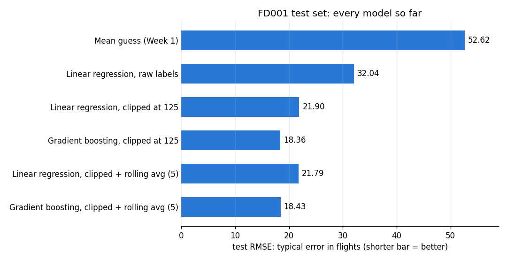
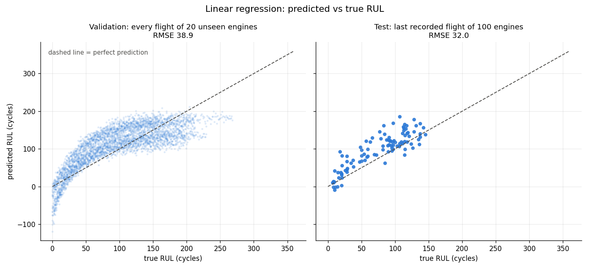
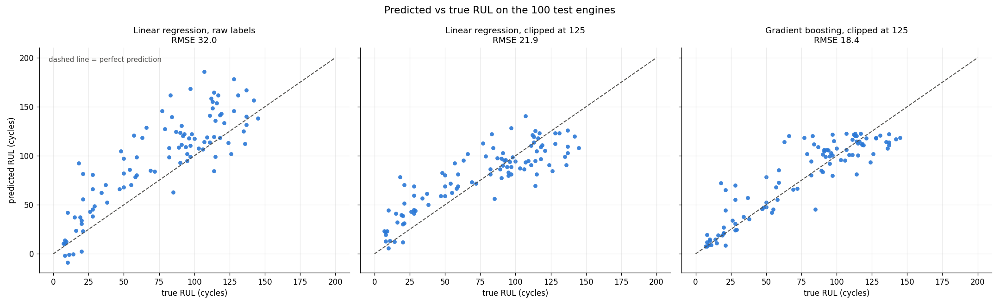
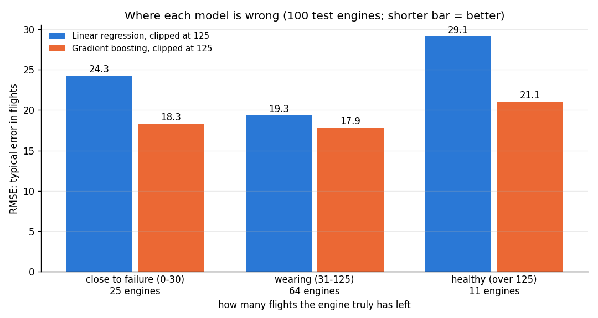
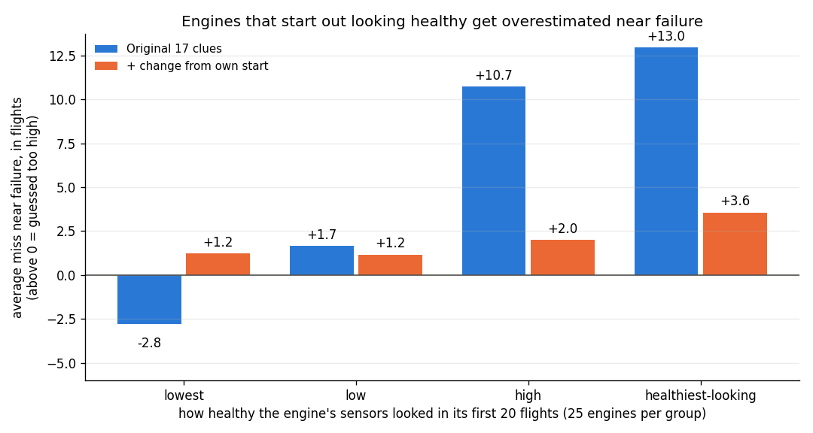
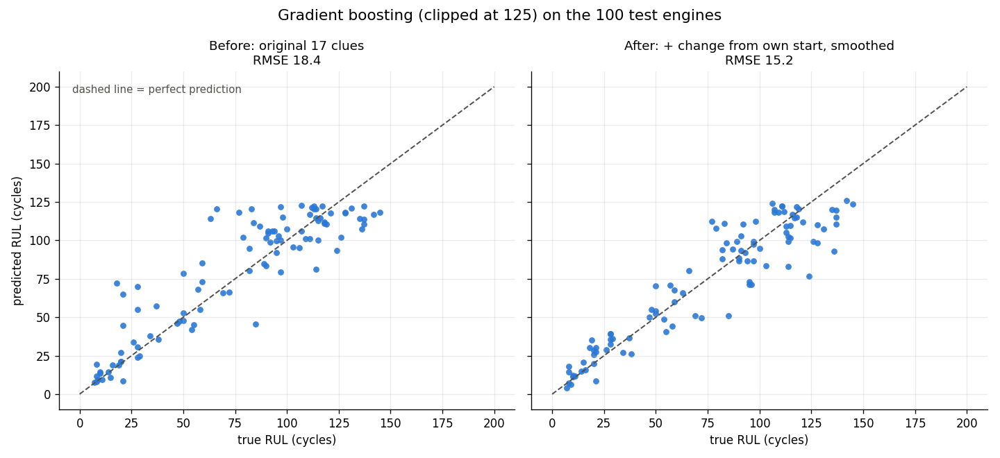
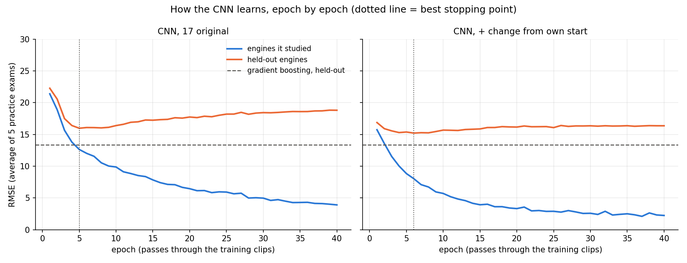
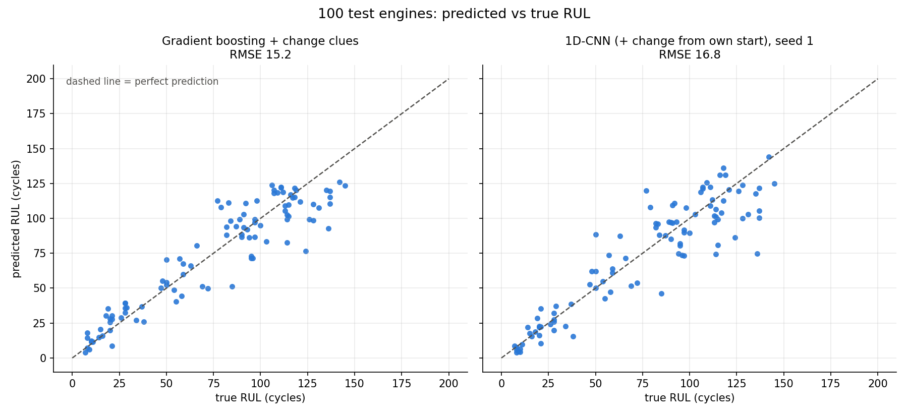
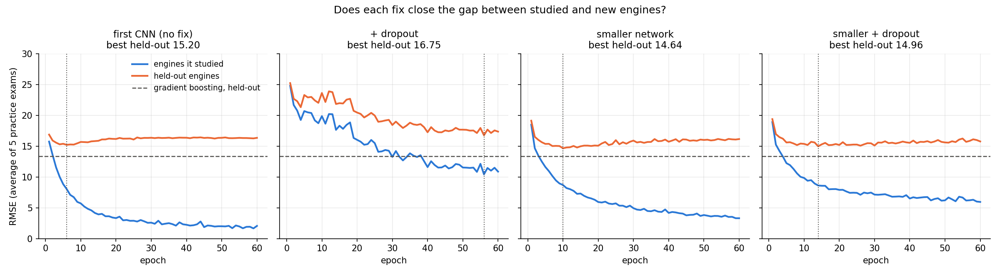

# NASA C-MAPSS Remaining Useful Life Prediction

**Goal:** predict how many flights a jet engine has left before it fails, using simulated NASA sensor data (C-MAPSS, subset FD001).

**Result:** a gradient boosting model predicts remaining life with a typical error of **15.2 flights** on 100 unseen test engines. Guessing the average for every engine gives an error of 52.6.

**Status:** Project 0 complete (Weeks 1 to 4, a follow-up investigation, and a first neural network, which did not beat gradient boosting). Next: improve the network, then NASA satellite imagery.

## Summary
- Each engine runs until it fails while 21 sensors record every flight. The task is to look at an engine partway through its life and say how many flights remain (its Remaining Useful Life, RUL).
- I built four models, each one a single change from the one before, so every improvement can be traced to its cause.
- The biggest single gain did not come from a better model. It came from changing the labels the model learns from (capping RUL at 125).
- One idea I expected to help, smoothing the sensor readings, did not help at all. That is reported below, along with the mistakes I made.
- Checking where the model was wrong turned up a few large, unsafe mistakes on engines close to failure. Tracking down the cause led to the best result: comparing each engine to its own starting level.

## Results
Scored on the last recorded flight of each of the 100 FD001 test engines. RMSE is the typical size of the error, in flights. Lower is better.

| Model | Test RMSE | Too high (of 100) | What changed |
|---|---|---|---|
| Mean baseline | 52.62 | 71 | Predicts the training average (107.8) for every engine; ignores the sensors |
| Linear regression, raw RUL labels | 32.04 | 85 | Uses 17 sensor and setting columns |
| Linear regression, RUL clipped at 125 | 21.90 | 58 | Same model; only the training labels changed |
| Gradient boosting, RUL clipped at 125 | 18.36 | 53 | 100 small decision trees instead of a straight line |
| Linear regression, clipped + rolling average | 21.79 | 59 | Added smoothed sensors: no real gain |
| Gradient boosting, clipped + rolling average | 18.43 | 59 | Added smoothed sensors: no real gain |
| **Gradient boosting, clipped + change from each engine's own start** | **15.18** | **53** | Added clues for how far each sensor has moved from that engine's first 20 flights |
| 1D-CNN neural network, same clues, last 30 flights | 17.03 (16.63 to 17.80) | 40 to 52 | Reads a clip of 30 flights instead of one; average of 5 random starts |
| 1D-CNN, smaller network, average of 5 networks | 16.84 | 43 | Smaller network to curb memorizing; the 5 networks' guesses averaged |

"Too high" counts engines where the model promised more life than the engine really had. That is the unsafe direction.



(The chart was drawn before the last row of the table was added.)

These match the reference numbers I set out to reproduce for these simple models. Published deep-learning results on FD001 are typically 12 to 16.

The first four rows can be reproduced with `src/05_week4.py`, and the last row with `src/06_engine_baselines.py`.

## How I kept the testing honest
- **The test set is used once per model, only for the final score.** Every choice (which model, which settings) was made using training engines only.
- **Validation by engine, not by row.** To check a model, I hold out whole engines. Two neighboring flights of one engine are nearly identical, so splitting them across the two groups would let the model be graded on rows it has practically already seen.
- **Cross-validation.** One 20-engine check is noisy: the same model scored anywhere from 37.6 to 44.6 depending on which engines were held out. For later choices I averaged five checks, with every engine held out once.
- **Only training labels are clipped.** Test engines are always graded against NASA's true RUL values.
- **Overfitting checks.** Each model is scored on engines it studied and on engines it never saw. For the final model those are 17.57 and 18.52, so it learned a pattern instead of memorizing.

## What each step showed

### What wear looks like


Sensors are flat and noisy while an engine is healthy, then bend sharply in roughly the last 100 flights. Engines with very different lifetimes (128, 199, 362 flights) follow the same shape near failure. The sensors track *closeness to failure*, not age.

### Where a straight-line model goes wrong


The dots form a curve because a straight-line model cannot follow curved wear. It predicts impossible negative RUL near failure, flattens out around 150 to 190 for healthy engines, and guesses too high for 85 of the 100 test engines.

### What clipping and gradient boosting changed


A healthy engine's sensors look the same at 300 flights left as at 150. Clipping relabels everything above 125 as "healthy", so the model only counts down once wear shows.



Left to right, the dots tighten around the dashed "perfect" line.

## Where the Week 3 model was wrong


The 100 test engines are sorted by how many flights they truly have left. Gradient boosting beats linear regression in every group, but its error is about 18 flights everywhere, including for engines close to failure.

Looking inside the 25 engines with 30 or fewer flights left:

- For most of them the model is close. The middle (median) miss is 4 flights, and 18 of the 25 are within 10.
- For 5 of them the model is too high by 23 to 54 flights. One engine had 18 flights left and the model said 72.
- All five had flown fewer than 170 flights, so they wore out early. I have not yet explained why the model misses them.

A few large misses in the unsafe direction matter more than the average suggests, so I investigated them (next section).

Clipping is not the cause. A model trained on labels capped at 125 cannot answer above 125, but a *perfect* clipped model would still score 3.74 on this test set, and leaving out the 11 healthy engines only moves the score from 18.36 to 18.00.

## Finding the cause, and a fix
**Cause:** every engine begins life at a slightly different sensor level, like people with different resting heart rates. The model judged all engines on one shared scale. An engine that starts out looking extra healthy can be badly worn and still show numbers that look normal.

I measured this on training engines only, each one predicted by a model that had never seen it:



Engines that started out looking healthiest were guessed 13 flights too high near failure (blue bars). Four of the five badly missed test engines started out on that side.

**Fix:** new clues that say how far each sensor has moved from that engine's own first 20 flights, plus a smoothed version of the same. These only use flights that have already happened (checked: rebuilding them with later flights deleted gives identical values).

| Clues | 5 practice exams (average RMSE) | Test RMSE | Test RMSE near failure | Near failure, over 20 too high |
|---|---|---|---|---|
| Original 17 | 18.57 | 18.36 | 18.34 | 5 |
| + change from own start | 13.68 | 14.78 | 7.13 | 0 |
| + change, also smoothed | 12.41 | 15.18 | 7.47 | 0 |



Honest notes:
- The practice exams preferred the smoothed version and the test set slightly preferred the plain one. With 100 engines that gap is noise, so I report the one the practice exams chose: 15.18.
- The idea came from studying mistakes on the test set, so the test set is not a perfectly fresh exam for this change. The cause and the fix were both confirmed on training engines alone, and all five practice exams improved by 4 to 7 flights.
- The five engines are still guessed 8 to 12 flights too high. Better, not solved.
- Smoothing did nothing in Week 3 but helps here. Smoothing a raw reading was not useful; smoothing the *change from the engine's own start* is.

## A first neural network (1D-CNN)
Every model above looks at **one flight at a time**. A 1D-CNN looks at a **clip of the last 30 flights** and slides small stencils along it to spot shapes like a rise or a bend. Each engine's history is cut into overlapping clips (flights 1-30, 2-31, ...), and each clip is labeled with the RUL at its last flight, so it never contains the future.

I compared two input sets and up to 40 training passes (epochs) on the same five practice exams. Gradient boosting was graded on exactly the same flights, because the network cannot answer before an engine has 30 flights.

| Model | 5 practice exams (same flights) | Test RMSE |
|---|---|---|
| Gradient boosting + change clues | 13.34 | 15.18 |
| 1D-CNN, 17 original columns | 15.97 | (not tested) |
| 1D-CNN, + change clues | 15.20 | 17.03 (average of 5 random starts) |





What it showed:
- **It did not beat gradient boosting**, on the practice exams or on the test set.
- **It overfits fast.** Error on the engines it studied keeps falling toward 2 to 4, but error on held-out engines is lowest after only 5 or 6 passes. With 100 training engines it starts memorizing almost at once.
- **It still needs the hand-made clues.** A 30-flight clip cannot see the engine's first 20 flights, so it cannot work out the starting level by itself.
- **It is safer in one way.** It guesses too high on fewer engines (40 to 52 of 100, vs 53), and no engine close to failure is guessed more than 20 flights too high.
- **Random starts matter.** The same network trained from five different random starting points scored from 16.63 to 17.80, so I report the average.

Reproduce with `src/07_cnn.py` (about 15 minutes).

### Trying to stop it memorizing
I tried three standard fixes, one at a time, on the same five practice exams with the same inputs and the same random start:
- **Dropout:** while learning, 30% of the network's signals are switched off at random, so it cannot lean on any single one.
- **Smaller network:** instead of remembering *where* in the clip each shape appeared, it only counts *how much* of each shape it saw (6,401 learned numbers instead of 37,153).
- **Both together.**



| Version | 5 practice exams | Test RMSE |
|---|---|---|
| First CNN (no fix) | 15.20 | 17.03 (average of 5) |
| + dropout | 16.75 | (not tested) |
| Smaller network (chosen) | 14.64 | 17.45 (average of 5) |
| Smaller + dropout | 14.96 | (not tested) |
| Smaller network, the 5 networks' guesses averaged | | **16.84** |
| Gradient boosting + change clues | 13.34 | **15.18** |

What it showed:
- **Memorizing is not the main limit.** The fixes shrank the gap between studied and new engines a little, but the error on new engines stays around 14.5 to 15 whatever I do. Only "dropout alone is worse" is bigger than the noise between practice exams.
- **Averaging 5 networks helps.** 16.84 beats each of the 5 single networks (16.96 to 17.78). I decided to try this before looking at the test set.
- **Gradient boosting still wins.** Likely reason (not proven): with only 100 training engines, and the hand-made clues already in place, a tree model suits this data better.

Reproduce with `src/08_cnn_overfitting.py` (about 30 minutes).

## What failed
- **The first neural network.** I hoped it would reach the published 12 to 16 range. It scored 17.03, worse than gradient boosting (15.18). Likely reasons (not proven): only 100 training engines, and the network memorizes them within a few passes.
- **Rolling-average features.** I expected smoothing the sensors to give a clear gain. It gave none. Cross-validation RMSE moved from 18.57 to between 18.22 and 18.49 depending on the window, while the five checks themselves range from about 16 to 20, so the differences are noise. Test RMSE went from 18.36 to 18.43. I checked the averages by hand and they are computed correctly. Likely reason (not proven): noise is not the main limit; engines differ from each other in ways smoothing cannot fix.
- **First leakage demonstration.** I tried to show that splitting by row gives a fake good score. With my real features it did not (by-row 52.60 vs by-engine 47.00). The fake boost only appears once the model can identify the engine (24.69 vs 47.30). I still split by engine, because it stays safe as features change.
- **Feature count.** My notes said 19 usable features. The data says 17. Seven columns never change (`op3, s1, s5, s10, s16, s18, s19`).
- **A plot bug.** My first sensor chart showed failure on the wrong side, because a shared axis was flipped six times.
- **A wrong expectation.** I assumed the model would be most accurate near failure, where the sensors change fastest. Measuring it by group showed otherwise.

## Limits of this work
- **Simulated data.** C-MAPSS is a NASA simulation, not real flight data.
- **The easiest subset.** FD001 has one operating condition and one fault type. The other three subsets are harder.
- **Small test set.** 100 engines. Differences of a few tenths of a flight between models mean nothing.
- **One number per engine.** The model gives a single guess with no measure of how sure it is.
- **Default settings.** The gradient boosting settings were not tuned.

## Next steps
1. Tune the model's settings, and test whether the starting-level idea holds on the harder subsets (FD002 to FD004).
2. Neural networks: try longer clips, longer dropout training, or an LSTM. The anti-memorizing fixes did not close the gap to gradient boosting.
3. Project 1: move from engine data to NASA HLS satellite imagery.

## Project layout
| Path | What it is |
|---|---|
| `src/cmapss.py` | Shared helpers: loading data, RUL labels, RMSE, splits, plots |
| `src/02_week1.py` to `src/05_week4.py` | Each week as a script (prints results, saves the plots) |
| `src/06_engine_baselines.py` | Follow-up: why some engines were overestimated, and the fix |
| `src/07_cnn.py` | First neural network: a 1D-CNN in PyTorch |
| `src/08_cnn_overfitting.py` | Three fixes for the CNN's memorizing, plus averaging 5 networks |
| `notebooks/01_week1.ipynb` to `07_cnn_overfitting.ipynb` | The same steps as notebooks, with explanations |
| `figures/` | Saved plots |
| `LOG.md` | Experiment log: every model, its score, and what I learned |

## Setup
```bash
python3 -m venv .venv                         # private package folder for this project
.venv/bin/pip install -r requirements.txt     # exact package versions used
.venv/bin/python src/05_week4.py              # rebuild the final results table (under a minute)
.venv/bin/python src/02_week1.py              # Week 1: labels, sensor plots, baseline
.venv/bin/python src/03_week2.py              # Week 2: linear regression, validation
.venv/bin/python src/04_week3.py              # Week 3: clipping, gradient boosting (a few minutes)
.venv/bin/python src/06_engine_baselines.py   # follow-up: the best model (a few minutes)
.venv/bin/python src/07_cnn.py                # neural network (about 15 minutes)
.venv/bin/python src/08_cnn_overfitting.py    # fixes for its memorizing (about 30 minutes)
.venv/bin/jupyter lab notebooks/              # or open the notebooks in your browser
```

## Data
NASA Prognostics Center of Excellence data repository, Turbofan Engine Degradation Simulation Data Set. Not included here; download it and place `train_FD001.txt`, `test_FD001.txt`, and `RUL_FD001.txt` in `data/`.
